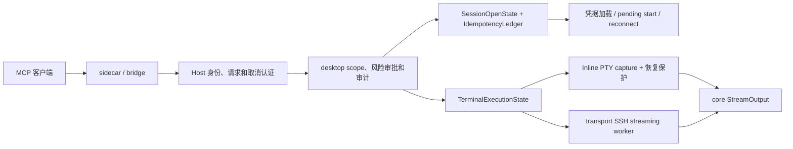

# MCP 执行与会话生命周期实现记录

基线：`869de7688c8d8f069371dd4f8895ac6d64657c7c`（执行开始时 `main` 已同步，工作区干净）。本次未修改持久化格式、数据库表、凭据封装、备份或同步格式，也未修改第三方 fork 或其 pinned revision。

## 根因与修复

1. **#1181：POSIX 命令边界。** 旧包装器把 `; }` 接在用户命令最后一行；heredoc delimiter 因此不再独占一行，尾部注释也可能吞掉包装器闭合语句。现在在当前 Shell 的分组内部保留命令内容，以显式换行分隔原命令和包装器，使用 `:` 保证空命令分组合法。分组结束后立即保存退出码，再发 END marker。PowerShell/Cmd 包装策略保持原样。
2. **超时后的 Shell 占用。** 旧 `finish()` 删除请求任务后，`busy()` 就把 Shell 当作空闲。现在请求结果、远端退出证据和恢复保护分别记录。超时、取消、不确定写入及输出丢失在没有退出证据时不会释放自动执行保护；匹配的迟到 END 可以补充退出码并确认恢复，但保留已经发生的超时或取消结果。END 已确认退出后请求取消，也保留退出码与 Shell 可用状态，不额外建立恢复保护。结果 TTL 到期不解除恢复保护。人工接管停止收集后续人工输出；确认 Shell 可用的标签菜单入口支持六种语言。
3. **会话重复及完成错配。** RPC ID、保存连接 ID 和打开操作 ID 分离。操作 ID 贯穿凭据加载、启动 options、pending start、重连及成功/失败完成；UI 完成没有 MCP 操作 ID，不能交付 MCP 请求。保存连接的独立创建操作串行排队；已开始操作在等待者取消后仍记录结果。复用仅依据真实 `sourceConnectionId`、当前 scope、连接及执行状态，并按默认会话、活动会话、session ID 选择。
4. **#1182：异步执行及 EOF 顺序。** 新的 Job 不继承 RPC token，由 desktop 的现有 Tokio 执行器持有。SSH streaming adapter 分别交付输出、状态、信号、EOF、Close 和错误。EOF 本身不证明退出；退出证据与输出流结束均观察到后才完成。旧同步 SSH collector 同样修正了 EOF 先到时遗漏退出状态的问题。

## 调用链和唯一所有权



- `CapabilityRuntimeState::session_opens` 唯一持有打开队列、操作及等待者；`ledger` 唯一持有幂等键指纹、结果、别名及过期记录。执行指纹规范化实际目标和有效默认超时，省略默认值与显式提供默认值对应同一操作。
- `TerminalExecutionState` 唯一持有 Job、Shell 占用、capture、恢复保护、停止状态、结果等待者及任务句柄。同步 MCP 执行是结果等待适配器；原生 AI 的默认执行策略继续保留。
- `nyaterm-transport::ssh_execution::streaming` 只拥有辅助 channel 的网络执行与事件发送。认证、Host Key 验证、连接匹配及首 channel 顺序复用既有 transport 入口。关闭共享连接的辅助执行不会断开用户连接。
- `nyaterm-core::capabilities::stream_output` 提供追加、UTF-8 字节分页和绝对游标；旧静态 `OutputStore` API 保留。异步 capture 不额外保存完整长输出。
- Host 签发恢复凭证，Host 内存只保存 hash；sidecar 以 `SecretString` 仅在内存保存凭证。取消连接也必须 attach 同一所有者。旧 socket 的 detach 不会清除已经恢复的新连接。

## 接口和兼容性

| 接口 | 行为 |
| --- | --- |
| `session_open` | 默认 `create`；可选 `reuse_or_create` 和 `idempotencyKey`。相同所有者、scope 和来源的并发复用请求可以合并。Explicit scope 不自动扩大。 |
| `get_environment` / `session_get` | 协商后增加真实来源 ID、终端可用状态和仅所有者可见的当前 Inline Job ID；无来源时省略。 |
| `terminal_execute` | 保留同步默认、超时范围和结果分页。可选幂等键；仅 `returnJob: true` 加 `jobId`。 |
| `terminal_start` | 默认 Inline PTY，显式 SSH Exec；默认 5 分钟，范围 1 秒至 24 小时。登记后及时返回实际启动状态和 `jobId`。 |
| `terminal_poll` | 默认 16 KiB，按 UTF-8 字节边界分页；结构化返回游标、滚动丢失、Job/远端/终端状态和时间。 |
| `terminal_stop` | 每 Job 最多发送一次安全 Ctrl+C 或 channel INT；区分接受、发送、确认结束、未确认、人工恢复和目标失效；不升级到 KILL。 |

**兼容性例外：** 集成客户端的旧本地后台执行模式保持默认行为，但该模式拒绝 `returnJob: true`。公共 Job backend 契约只定义 `inline_pty` 和 `ssh_exec`；可轮询的本地任务应使用 `terminal_start inline_pty`。已在中英文使用指南说明。

Host/sidecar 协商 `client_resume` 和 `mcp_lifecycle`。新 sidecar 对旧 Host 不发布新工具，旧输入 Schema 移除新增参数，说明也不建议旧 Host 不支持的复用或幂等参数；旧 sidecar 对新 Host 保留原结果字段。三种 Job 工具发布共享输入及结果 Schema；原工具保持旧分页结果契约。

## 生命周期与资源限制

- 启动、运行、中断、完成、失败、超时、取消、断线和未知分别记录；远端退出证据与终端可用状态独立。
- Inline PTY 的中断必须匹配当前 capture、占用、目标及所有者，且没有人工接管。普通输出、时间经过和单次 Ctrl+C 均不会解除恢复保护。
- SSH Exec 两秒内没有退出证据则停止状态为未确认；提交执行前已确认取消时，停止状态为确认结束、远端状态为未启动。执行期限到达后关闭辅助 channel，保留未知远端状态。关闭 receiver 由 worker 自行清理 channel；回收任务句柄不靠丢弃执行 Future 中断进程。
- 输出上限：每 Job 4 MiB、每所有者 16 MiB、全局 64 MiB；滚动删除旧输出并返回 `baseOffset`。活动 Job 上限：每所有者 8、全局 32。保留结果元数据另有每所有者 128、全局 512 的上限。
- 结束结果保留十分钟，由定时器清理。幂等记录上限为每所有者 256、全局 1024；失效记录不被驱逐后重新执行。Host 恢复身份在最后连接断开十分钟后失效，无法恢复的身份才释放其幂等记录。
- 每次 poll、stop、幂等恢复检查所有者与当前 scope，包括关闭目标的原窗口/Explicit 范围。pending 会话幂等重试也在交付时重新检查各等待者的 scope。
- 审计区分 Job 登记、RPC 结束、中断发送和退出确认；迟到 END 的确认也记录，原生 AI 不写成 MCP Job 审计。命令、输出、秘密和恢复凭证不写入这些审计事件。

## 验证记录

完整 workspace 测试通过：5718 项通过、0 项失败、37 项保持 ignored。完整测试后的最后两项收尾（取消与 END 的竞争、旧 Host 的工具说明）又分别通过最新 desktop 能力测试 41 项和 sidecar 测试 15 项，并重新通过 workspace check。真实 Bash/PTY 测试 2 项、受控 SSH 测试 4 项、共享协议测试 7 项均通过。最终 `cargo fmt --all -- --check`、`cargo clippy --offline --workspace --all-targets` 与 `git diff --check` 均通过；clippy 没有 warning。

37 项 ignored 主要为现有性能测量、需要 X11/外部 SSH/SFTP/WebDAV/tmux/trzsz-go 的测试、实际便携包验证和一个既有 GPUI 输入 fixture。没有新增 ignored 或用跳过用例掩盖失败。

真实 Bash/PTY 测试使用 transport 的实际队列写入接口；受控 SSH 测试使用 loopback 上的真实加密 russh channel，验证 EOF 先于退出状态、退出状态后尾部输出、一次 INT、忽略 INT 后超时及旧同步 collector；提交前取消测试验证不建立连接。

已执行命令（Linux x86_64，依赖均已缓存）：

```bash
cargo test --offline --workspace capability_runtime -- --test-threads=8
cargo test --offline --workspace --test agent_capture_pty --test ssh_exec_stream
cargo test --offline -p nyaterm-mcp-protocol -p nyaterm-mcp
cargo test --offline -p nyaterm-mcp
cargo check --offline --workspace
CARGO_TARGET_X86_64_UNKNOWN_LINUX_GNU_RUNNER=/tmp/nyaterm-mcp-test-runner cargo test --offline --workspace -- --test-threads=8
cargo fmt --all -- --check
cargo clippy --offline --workspace --all-targets
git diff --check
```

测试 runner 内容（仅调整测试进程身份，不改应用环境变量）：

```bash
#!/bin/bash
set -e
case "$1" in
    */nyaterm_files-*) exec setpriv --reuid=65534 --regid=65534 --clear-groups "$@" ;;
    *) exec "$@" ;;
esac
```

当前环境：Linux x86_64，无图形显示。GPUI 使用测试上下文验证状态和分发，没有实际窗口交互验证。macOS、Windows、实际外部 SSH 服务器、跨平台字符编码和 Telnet 服务端兼容性均未实测；受控 loopback Telnet 分发测试仅验证应用的写入与生命周期路径。

初次 workspace 测试出现高并行 WebDAV 集成测试超时（单独重试通过），以及 root 的 DAC bypass 使既有只读文件测试不符合普通用户语义（非特权身份复验通过）。仅去掉 root 的 DAC capabilities 也不能模拟普通用户：已有上传测试根据 UID 进入跨用户文件权限分支，该混合环境会使其失败。整个 workspace 降权又使三个现有 PTY 清理测试无法进入继承的 `/root` 主目录。因此最终 Cargo runner 只以 UID/GID 65534 执行 files 单元测试二进制，其余测试使用原有环境，统一限制为八线程；Cargo 自身仍由当前用户执行。另已以非特权身份独立验证完整 files 包：204 项单元测试和 2 项集成测试通过，4 项需要外部环境的测试保持 ignored。没有跳过只读文件测试、修改主目录环境或修改文件服务代码。

## 主要文件

- `crates/nyaterm-core/src/agent_capture.rs`：POSIX 包装器。
- `crates/nyaterm-terminal/src/agent_capture.rs`：capture、流式输出、退役过滤器。
- `crates/nyaterm-desktop/src/features/capability_runtime/{session_open,idempotency}.rs`：会话操作与幂等。
- `crates/nyaterm-desktop/src/features/capability_runtime/terminal_execution{.rs,/jobs.rs}`：统一执行和恢复。
- `crates/nyaterm-transport/src/ssh_execution{.rs,/streaming.rs}`：同步 collector 和 streaming adapter。
- `crates/nyaterm-mcp-protocol/src/lib.rs`、`crates/nyaterm-mcp/src/{main,bridge}.rs`、`crates/nyaterm-desktop/src/features/mcp/server{.rs,/client_owners.rs}`：共享契约、协商、所有权和取消认证。
- `crates/nyaterm-transport/tests/{agent_capture_pty,ssh_exec_stream}.rs`：实际 PTY/加密 SSH 集成验证。
- 中英文 `docs-site/**/guide/ai-assistant.md`：工具使用、恢复流程和兼容性说明。
